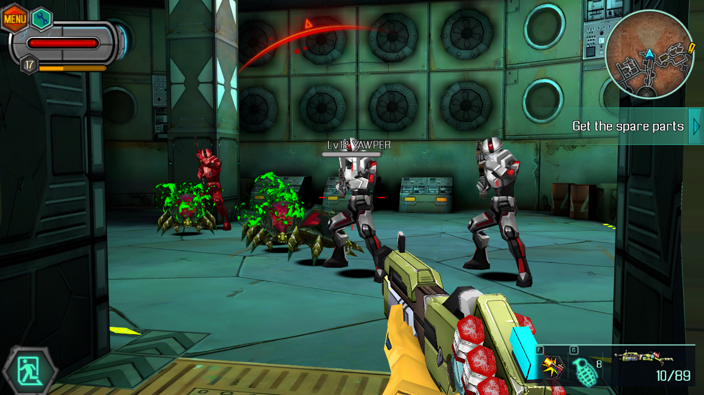
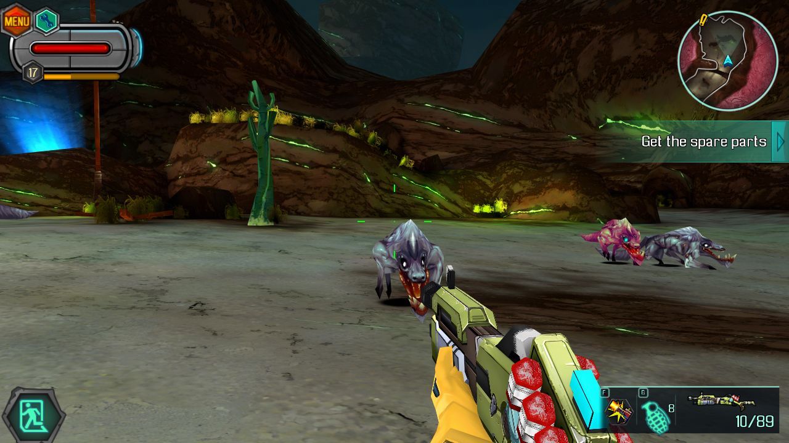
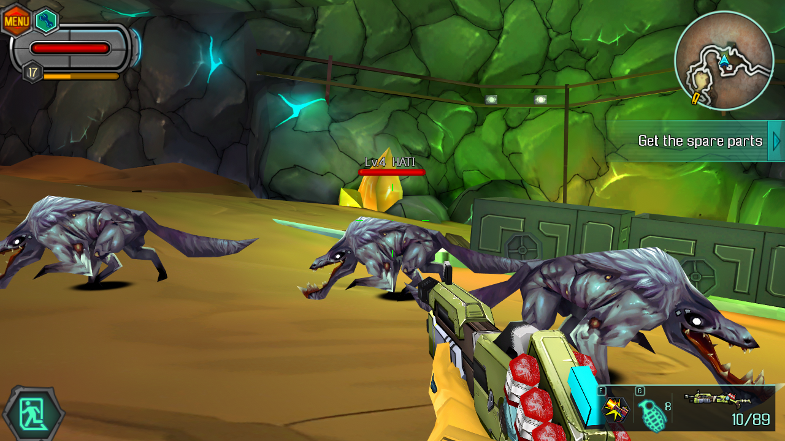
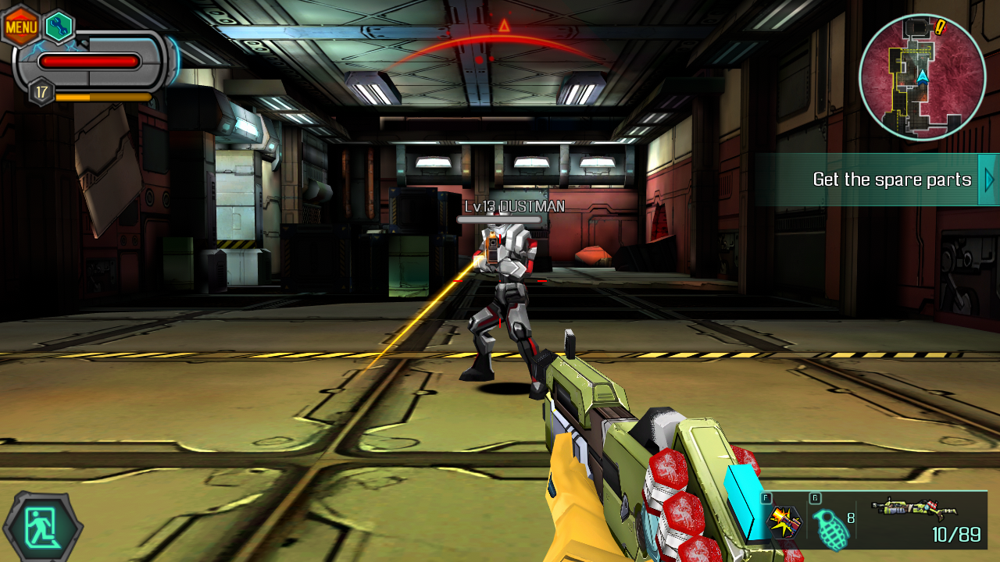
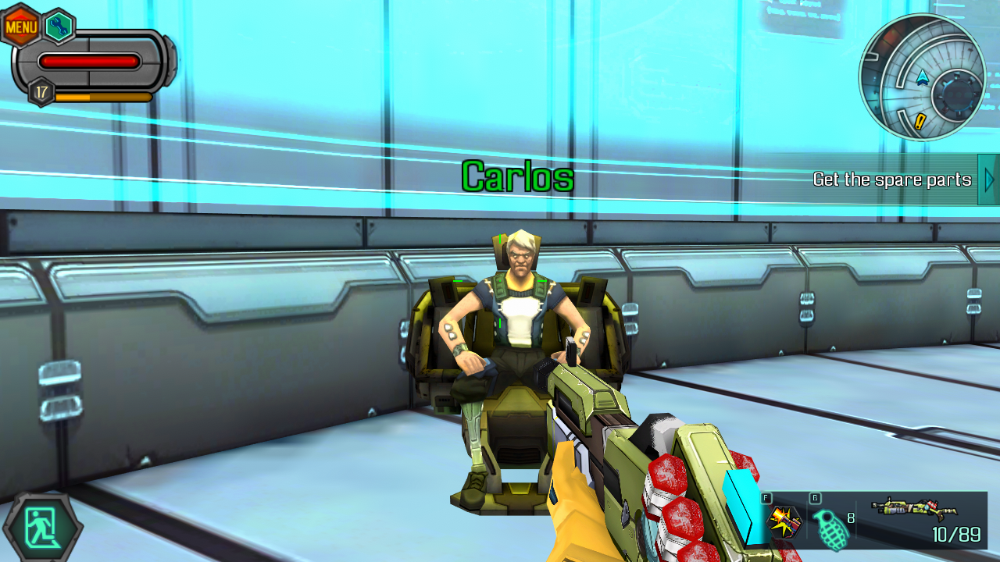
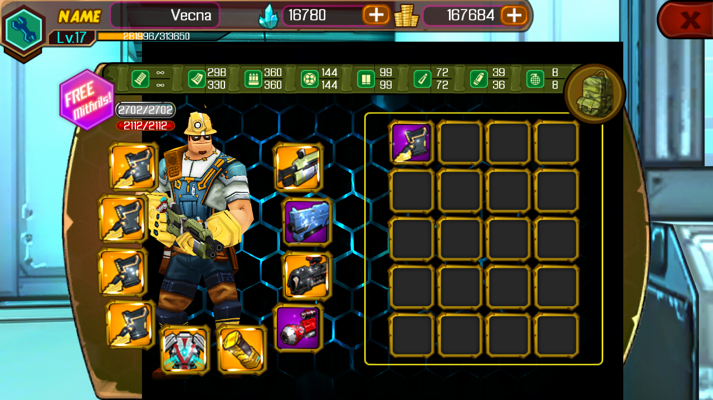
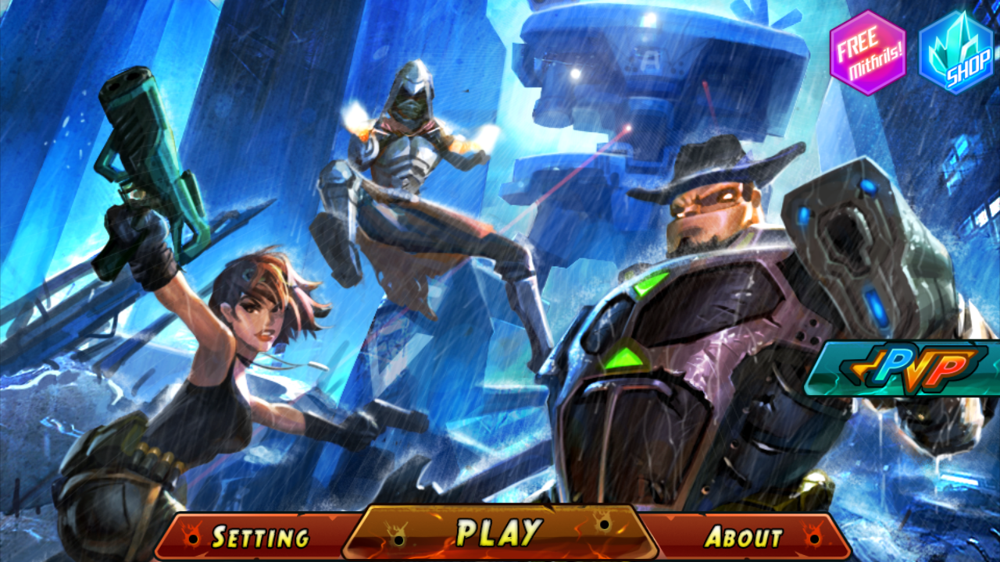

<div align="center">

# Bounty Hunter: Black Dawn — PC Port

**An unofficial native Windows port and optional remaster of *Bounty Hunter: Black Dawn*, the sci-fi action-RPG shooter by Freyr Games.**  
Rebuilt as a Unity 6 project with full keyboard & mouse controls, a custom PC HUD, a rotating minimap, and AI-upscaled textures.


<br>



*First-person combat in a sci-fi facility — featuring the redesigned PC HUD, rotating circular minimap, restored baked lighting, 8x MSAA, Post-FX, and 4x upscaled 3D textures.*

</div>

> [!IMPORTANT]
> **This repository contains no game files, assets, or builds.**  
> You need your own copy of *Bounty Hunter: Black Dawn* **Android v1.25.01** (`.xapk` or `.obb`). `tools/setup.py` extracts, patches, remasters, and compiles `BountyHunter.exe` locally on your machine.

---

## Features

### Native PC Experience
- **Standalone Windows executable (`BountyHunter.exe`)** — launches full screen at your monitor's native resolution (`Alt+Enter` switches between full screen and windowed mode).
- **Keyboard & mouse controls** — raw mouse look, `WASD` movement, `Shift` sprint, `Space` jump, `E` to interact/loot/talk, and direct hotkeys for weapons, skills, grenades, melee, and menus.
- **Smart PC cursor** — locked during combat and freed automatically in menus or while holding `Left Alt` to click HUD buttons and NPCs.

### Redesigned PC Interface
- **Streamlined PC HUD** — removes mobile touch buttons for aim/melee and docks active skills, grenades, and equipped weapon ammo in a clean bottom-right panel with keybind badges.
- **Rotating circular minimap** — replaces the mobile top bar with a camera-aligned minimap showing quest objectives, NPCs, portals, shops/upgrade machines, and active enemies (`Tab` to toggle).

### Campaign & Economy
- **Playable offline campaign** — play through the single-player story missions, hubs, and arenas (the original online servers are shut down, so multiplayer is not supported).
- **Free in-game store** — all Mithril packs in the store are free on PC, and Mithril can be traded for Gold in the Exchange tab.

### Visual Remaster
- **Restored baked lighting** — brings back the original Unity 4 lightmaps across scenes and streamed level blocks.
- **8x MSAA & Post-Processing** — adds Ambient Occlusion, selective Bloom, and subtle Color Grading on the world camera (toggle anytime with `F9`).
- **4x AI-upscaled 3D textures** — upscales environment, enemy, character, and weapon textures via Real-ESRGAN while leaving NGUI UI atlases untouched and sharp (optional; skip with `--no-upscale`).

---

## Screenshots

<table>
  <tr>
    <td width="50%" align="center">
      <br>
      <sub><b>Outdoor Missions</b> — Alien canyon vistas, portals, and creature packs</sub>
    </td>
    <td width="50%" align="center">
      <br>
      <sub><b>Crystal Caverns</b> — Restored lightmaps and Post-FX bloom</sub>
    </td>
  </tr>
  <tr>
    <td width="50%" align="center">
      <br>
      <sub><b>Station Firefights</b> — Crisp 4x textures, 8x MSAA, and weapon viewmodels</sub>
    </td>
    <td width="50%" align="center">
      <br>
      <sub><b>City Hubs</b> — Quest NPCs, shops, and rotating minimap</sub>
    </td>
  </tr>
  <tr>
    <td width="50%" align="center">
      <br>
      <sub><b>Loadout & Loot</b> — RPG gear slots, weapons, ammo reserves, and stats</sub>
    </td>
    <td width="50%" align="center">
      <br>
      <sub><b>Main Menu</b> — Direct access to campaign and free Mithril store</sub>
    </td>
  </tr>
</table>

---

## Requirements

- **OS:** Windows 10 or 11 (64-bit).
- **Game data:** Android version **1.25.01** — either the `.xapk` package or `main.9.com.ifreyrgames.blackdawn.obb` (found in `Android/obb/com.ifreyrgames.blackdawn/` on a device with the game installed).  
  Setup verifies the OBB SHA-256: `9553549644578258388e3fd0a73b2855411a8f4bfa5aa8e045e15a378dc0aaac`.
- **Unity:** [Unity Hub](https://unity.com/download) with Unity **6000.0.85f2**, signed in with a free Personal license.
- **Tools:** [Python 3.10+](https://www.python.org/downloads/) and [Git for Windows](https://git-scm.com/download/win).
- **Disk space:** ~20 GB free.
- **GPU:** Vulkan-capable GPU for AI texture upscaling (optional — pass `--no-upscale` to skip).

Setup automatically downloads [AssetRipper](https://github.com/AssetRipper/AssetRipper) `2.0.0` and [Real-ESRGAN](https://github.com/xinntao/Real-ESRGAN) (`ncnn-vulkan`) from their official GitHub releases and verifies their SHA-256 hashes.

---

## Build & Play

```powershell
git clone https://github.com/vecnam/bounty-hunter-black-dawn-pc
cd bounty-hunter-black-dawn-pc
python tools/setup.py C:\path\to\your-game-file.xapk
```

The first run takes a few hours (asset export, Unity import, NavMesh rebuild, and AI texture upscaling). If interrupted, run `python tools/setup.py` again to resume from the last completed step.

When finished, launch **`game\BountyHunter.exe`**. A quick reference (`README.txt`) is copied right next to the executable, and saves live in:

```text
%USERPROFILE%\AppData\LocalLow\Freyr\Bounty Hunter Black Dawn
```

### Build Options

- `--no-upscale` — skips the Real-ESRGAN texture upscale. You can add it later with `python tools/setup.py --from upscale`.
- `--from STEP` — restarts the pipeline from a specific step.
- `UNITY_EXE` — set this environment variable to your `Unity.exe` path if Unity `6000.0.85f2` is not in `C:\Program Files\Unity\Hub\Editor\6000.0.85f2`.

<details>
<summary>Pipeline steps run by <code>tools/setup.py</code></summary>

1. `extract` — verifies the OBB SHA-256 and unpacks assets and bundles.
2. `export` — exports the Unity 4 project with AssetRipper 2.0.0.
3. `populate` — copies assets into `BountyHunterPC/` and applies code patches from `patches/`.
4. `fixes` — resolves duplicate prefab fileIDs, ports NGUI/world shaders to HLSL, and maps bundles to `Resources/bundles`.
5. `particles` — converts legacy Unity 4 emitters to `ParticleSystem`.
6. `static-batch` — restores Unity 4 static batching meshes for Unity 6.
7. `navmesh` — decodes legacy Detour tiles and rebakes ground, jump-link, and flying NavMeshes.
8. `lightmaps` — injects `PcPortLightmaps` to restore baked scene/block lighting at runtime.
9. `upscale` — runs Real-ESRGAN x4plus on 3D textures (skipped with `--no-upscale`).
10. `release` — builds the final `game\BountyHunter.exe`.

</details>

---

## Controls

| Action | Key / Input |
|---|---|
| Move | `W` `A` `S` `D` (or Arrow keys) |
| Run | Hold `Left Shift` |
| Look / Aim | Mouse |
| Shoot | `Left Mouse Button` (or `Left Ctrl`) |
| Aim / Zoom | `Right Mouse Button` |
| Reload | `R` |
| Switch Weapon | `1`, `2`, `3`, `4` |
| Jump | `Space` |
| Grenade | `G` |
| Melee | `V` |
| Power 1 / Power 2 | `F` / `C` |
| Interact (talk, open chests, pick up items, advance dialog) | `E` |
| Backpack / Map / Quests | `I` / `M` / `Q` (or `U`) |
| Minimap On / Off | `Tab` |
| Achievements / Skill Tree | `Y` / `K` |
| Options / Pause | `O`, or `Esc` in combat |
| Free Cursor to Click HUD / NPCs | Hold `Left Alt` |
| Toggle Post-Processing | `F9` |
| Full Screen / Windowed | `Alt+Enter` |

---

## Troubleshooting

- **"not the expected game data"**: The file is not Android v1.25.01. The patches are tailored strictly to that version's SHA-256.
- **Unity stops with a license message**: Open Unity Hub, sign in, and activate a free Personal license, then run setup again. For the Microsoft Store version of Unity Hub, `tools/unity.py` automatically copies the license to where batch mode expects it.
- **Logs**: Setup and Unity build logs are saved in `build\*.log`; runtime logs are written to `Player.log` inside the save folder.

---

## Contributing

Read [AGENTS.md](AGENTS.md) before making changes — it documents the rules, repository layout, patch workflow, and test harness for both human contributors and AI coding agents.

---

## Legal

This is an unofficial fan project and is not affiliated with or endorsed by Freyr Games. *Bounty Hunter: Black Dawn* and all of its content belong to their respective owners.

This repository contains no game assets and no game binaries: the port is built locally on your computer from your own copy of the game. The files in `patches/` contain only minimal lines of decompiled code as diff context. All original port code and documentation in this repository are licensed under the [MIT License](LICENSE).

Please do not upload game files, assets, or compiled builds to this repository, its issues, or its pull requests.
